# Fractonica clock for ESP32

Firmware for a small physical Fractonica clock: an eclipse-anchored harmonic
clock on an ESP32 with a small display. It shows the present as a ring of
nested alternating circular arcs with the phase-glyph odometer at its centre,
lets you step through the temporal scales, inspect one, read the Sun (the
solar sync), and switch between two modes:

- **PURE** shows only Fractonica units: never a date, an hour, a zone, a
  hertz, a metre or a per cent.
- **EARTH** adds the Gregorian / SI translation, every one led by ⊕, at a
  fixed UTC offset.

All clock arithmetic, names and text come from the shared C core in the
sibling checkout [`../core`](../core). The look is the Astrolabe design
language, [`../design/astrolabe/DESIGN.md`](../design/astrolabe/DESIGN.md).

> **Status: all five stages done; verified on the host only.** The firmware
> builds without a warning for ESP32, ESP32-S3 and ESP32-C3 with every
> supported display, with `idf.py` and with PlatformIO, and every face has
> been rendered and checked against the core at three SPEC test vectors.
> **It has never run on a chip:** no board was attached to the machine it was
> written on, and ESP-IDF's QEMU is not installed there. What is proven is
> proven on the host: the same UI library and the same application loop run
> in the simulator and its tests. Stage 5 answered two reviews (17 findings:
> AGENTS.md section 11). See
> [What is verified](#what-is-verified-and-what-is-not) and the
> [bring-up checklist](#bring-up-checklist-first-flash-on-real-hardware).

Working on the code? Start with [AGENTS.md](AGENTS.md).

## The faces

Simulator renders at 2026-10-08 12:00 UTC (SPEC test vector A,
`α#6 β#4 γ#9 δ#3 ε#5 34η 29ι 21λ 3ν`), kept in [`docs/`](docs):
`cd sim && make pictures`. EARTH pictures use UTC+2.

**GC9A01, 240 x 240 round** (no words on the instrument; the cards are the text)

| NOW | SCALES | LENS | SUN (EARTH) | STAMP |
|---|---|---|---|---|
| 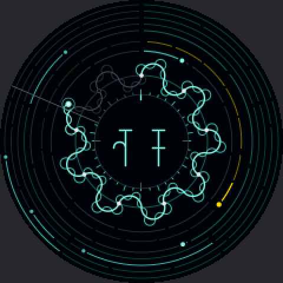 | 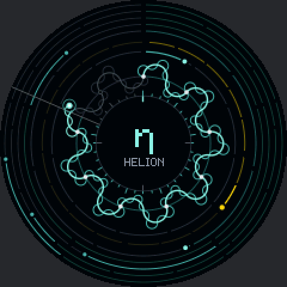 | 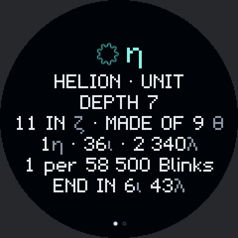 | 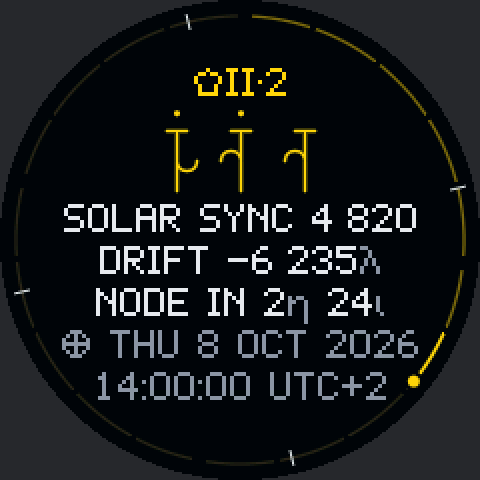 | 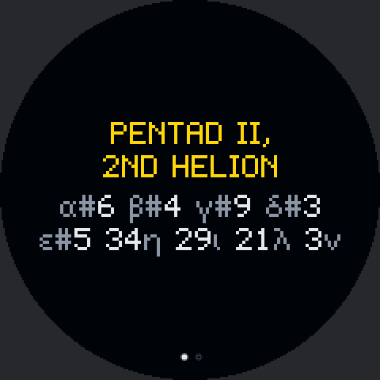 |

| NOW (EARTH) | LENS (EARTH) | focus δ | focus κ | time not set | out of catalogue |
|---|---|---|---|---|---|
| 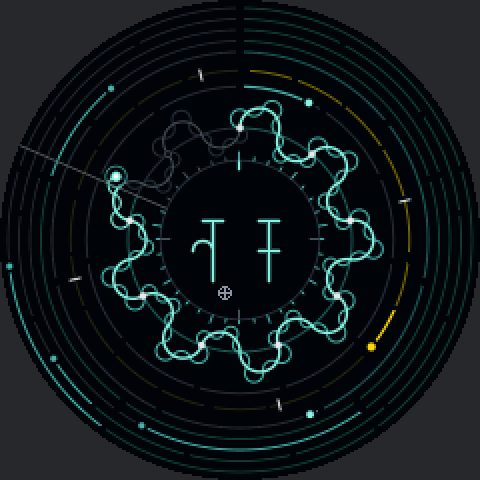 | 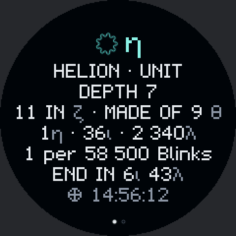 | 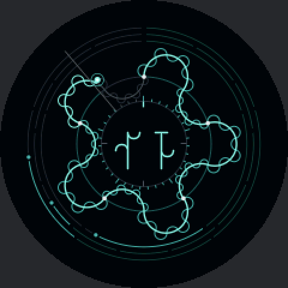 | 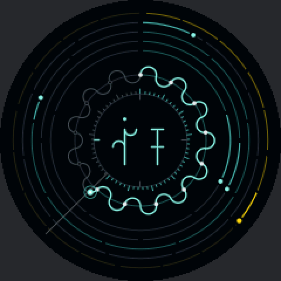 | 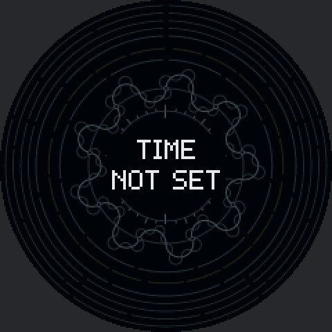 | 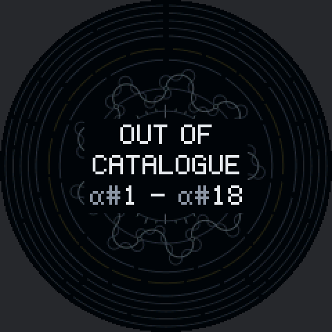 |

**ST7789, 240 x 240** (the same instrument at 5/7 size over three rows of text)

| NOW | NOW (EARTH) | LENS (EARTH) | SUN | STAMP |
|---|---|---|---|---|
| 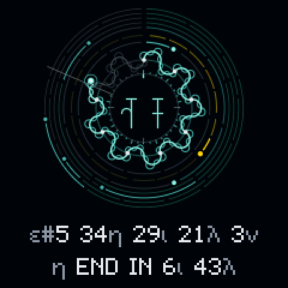 | 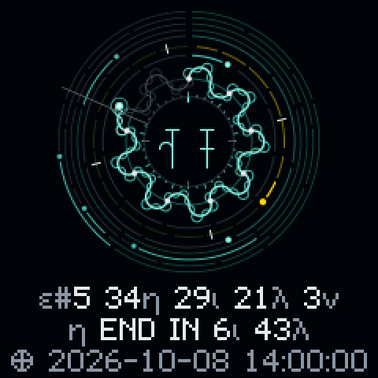 | 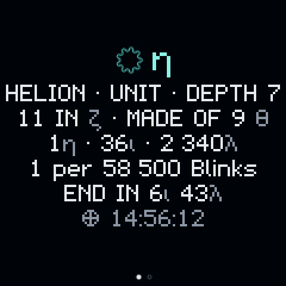 | 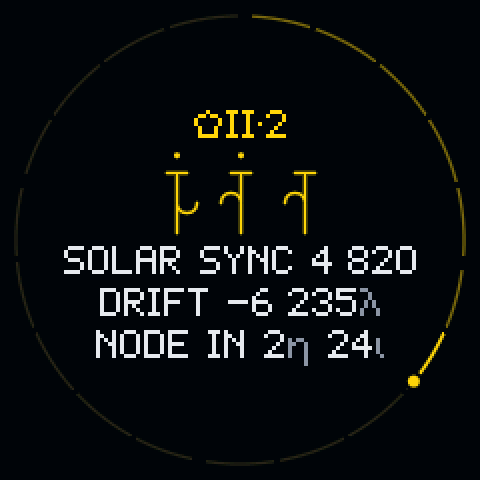 | 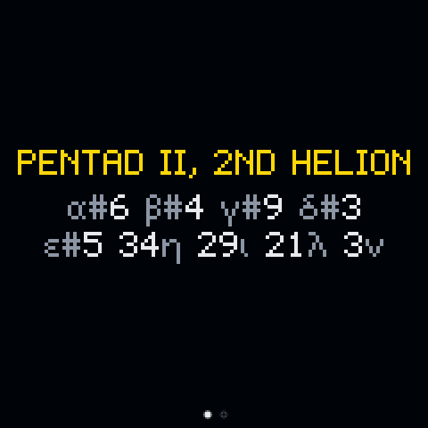 |

**ST7789, 240 x 320**

| NOW | NOW (EARTH) | LENS (EARTH) | SUN | STAMP |
|---|---|---|---|---|
| 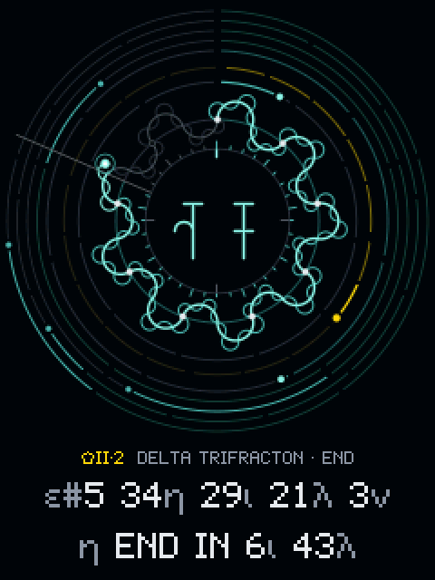 | 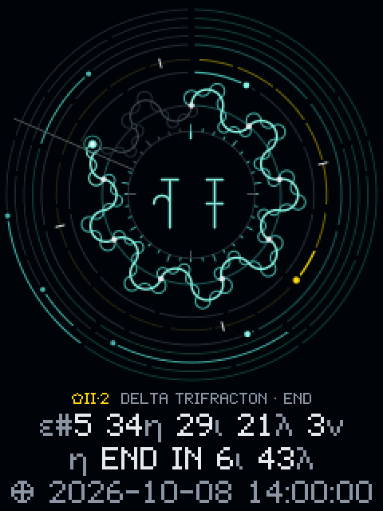 | 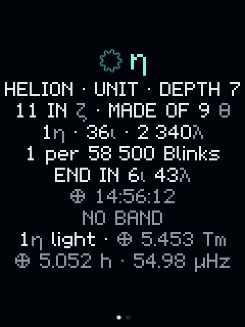 | 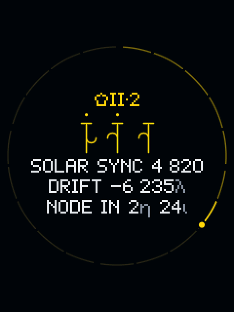 | 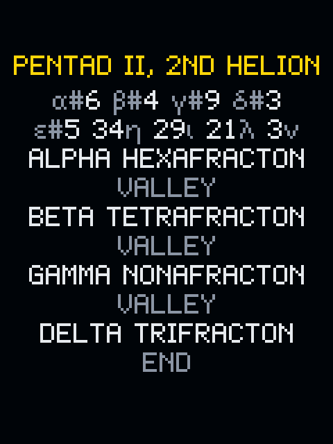 |

**SSD1306, 128 x 64 one-bit** (solid arc = elapsed, dotted = to come, block = now, bead = count)

| NOW | LENS | LENS (EARTH) | SUN | STAMP | time not set |
|---|---|---|---|---|---|
| 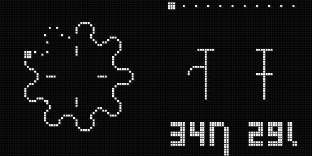 | 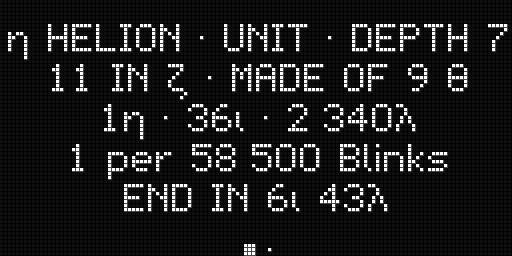 | 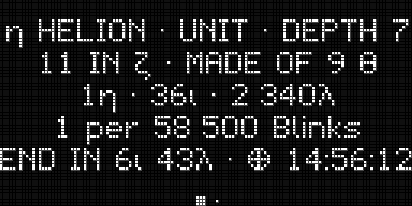 | 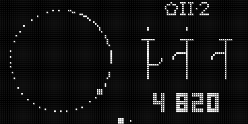 | 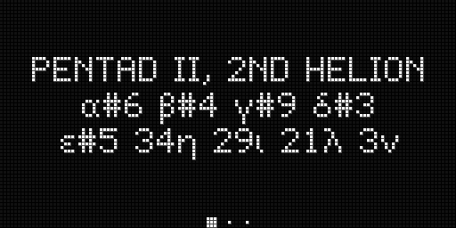 | 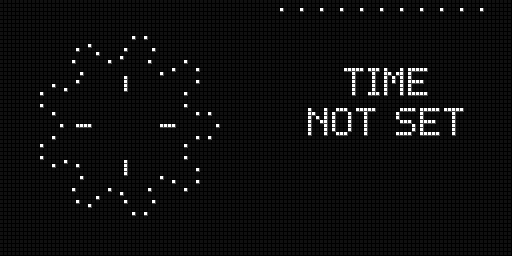 |

| Screen | What it shows |
|---|---|
| **NOW** | The instrument: the focused cycle as a ring of nested arcs (lit = elapsed), a bead per child cycle, the bezel graduated in grandchild cycles with four quarter ticks (the next one lit), the two-glyph odometer at the centre, one counter ring per longer period around it, and the Sun's ring while the focus is the Helion or finer. Rectangular faces add the reading (`ε#5 34η 29ι 21λ 3ν`) and a countdown (`η END IN 6ι 43λ`). |
| **SCALES** | The same instrument refocused one level finer or coarser; the level is named at the centre for a moment. |
| **LENS** | A card for one level, any of the 63: letter, name, kind, cycles per parent, what it is made of (nothing for the last rung, ο2: the ladder ends there), its length as spans, its rate (`1 per 58 500 Blinks`, `7 pB`), the next threshold, its band (`NO BAND` outside every band), and its length as a span of light (`1η light`). The 240 x 320 face adds the same length in the six other media (`AIR 5.15ο`). EARTH sets the translation beside or under each: the threshold's civil time (its date when it is another day), metres, period and frequency. |
| **SUN** | The solar sync as a ring of 19 Helions with its three-glyph odometer, the Pentad, the sync number, the drift, the next node. EARTH adds the civil date-time and marks the civil midnights on the ring. |
| **STAMP** | The moment in full: Pentad, the four major periods by name, the stamp. EARTH adds the civil date-time. |

EARTH only ever adds: no Fractonica line gives way to a translation on any
face (held by a test). Every translation is led by ⊕ and drawn in ash.

Until the clock knows the time it says `TIME NOT SET`; outside the eclipse
catalogue (before 1613 or after 2857) it says `OUT OF CATALOGUE · α#1 – α#18`.
It never shows a wrong reading instead.

### Getting around

```
NOW ──NEXT / PREV──▶ SCALES   one level finer / coarser (levels 0..13, wrapping);
 ▲  ◀─ 2.5 s without ─┘  │    the level is named at the centre
 │       input           │
 │                     SELECT: inspect the level just turned to
 │                       ▼
 └────────SELECT───────▶ LENS ─SELECT─▶ SUN ─SELECT─▶ STAMP ─SELECT─▶ NOW

SELECT  always "further": on a card of several pages (the dots at the
        bottom) it turns the page, and leaves the card from its last page
LENS    NEXT / PREV go through all 63 levels; looking at one does not
        change the instrument's focus
SUN     NEXT = SELECT; PREV = a page back, then LENS
STAMP   NEXT = SELECT; PREV = a page back, then SUN
LONG    anywhere: PURE <-> EARTH
```

| Input (build-time choice) | NEXT | PREV | SELECT | LONG |
|---|---|---|---|---|
| Rotary encoder with push (default) | turn clockwise | turn back | push | hold the push 0.6 s |
| Three buttons | B | C | A | hold A |
| Two buttons | A | hold A | B | hold B |
| One button | click | (NEXT wraps around) | double click | hold |

The mode, the focus, the screen, the UTC offset and the brightness are
remembered across power cycles (written to flash five seconds after the last
change, once).

## Hardware

The owner named no hardware, so **every default below is an assumption**:
the common development kit of each chip and the cheapest module of each
display. Everything is a build-time choice (`idf.py menuconfig` →
*Fractonica clock*); no C file holds a pin number.

| | Choices | Default |
|---|---|---|
| Chip | ESP32, ESP32-S3, ESP32-C3 (ESP-IDF 5.5) | any of the three |
| Display | GC9A01 240 x 240 round colour (SPI); ST7789 240 x 240 or 240 x 320 colour (SPI); SSD1306 128 x 64 one-bit (I2C) | GC9A01 |
| Input | rotary encoder with push; three, two or one button; none (console only) | encoder |
| Time | Wi-Fi + SNTP; the serial console; a compile-time demo instant | console |

### Wiring (default pin maps)

Colour panels on SPI (GC9A01, ST7789). Module pin names vary: SCL = SCK =
CLK, SDA = MOSI = DIN, BLK = BL = LED.

| Display pin | ESP32 (DevKitC) | ESP32-S3 (DevKitC-1) | ESP32-C3 (DevKitM-1) |
|---|---|---|---|
| SCL (clock) | GPIO 18 (VSPI) | GPIO 12 (FSPI) | GPIO 6 |
| SDA (data in) | GPIO 23 | GPIO 11 | GPIO 7 |
| CS | GPIO 5 | GPIO 10 | GPIO 10 |
| DC | GPIO 16 | GPIO 13 | GPIO 3 |
| RST | GPIO 17 | GPIO 14 | GPIO 4 |
| BL (backlight) | GPIO 4 | GPIO 21 | GPIO 5 |
| VCC, GND | 3V3, GND | 3V3, GND | 3V3, GND |

(On ESP32-WROVER modules GPIO 16 / 17 belong to the PSRAM: move DC and RST.)

SSD1306 on I2C, address 0x3C:

| Display pin | ESP32 | ESP32-S3 | ESP32-C3 |
|---|---|---|---|
| SDA | GPIO 21 | GPIO 8 | GPIO 4 |
| SCL | GPIO 22 | GPIO 9 | GPIO 5 |
| VCC, GND | 3V3, GND | 3V3, GND | 3V3, GND |

Input. Every contact switches the pin to GND; the chip's internal pull-ups
are on (the ESP32's GPIO 34..39 have none: do not use them without
resistors).

| Signal | ESP32 | ESP32-S3 | ESP32-C3 |
|---|---|---|---|
| Encoder A (CLK) | GPIO 32 | GPIO 4 | GPIO 0 |
| Encoder B (DT) | GPIO 33 | GPIO 5 | GPIO 1 |
| Button A (encoder push / the one button) | GPIO 25 | GPIO 6 | GPIO 9 (the kit's BOOT button) |
| Button B (two or three buttons) | GPIO 26 | GPIO 7 | GPIO 1 |
| Button C (three buttons) | GPIO 27 | GPIO 15 | GPIO 0 |

The console is UART0, the USB-serial port of the development kits, 115200 baud.

## Configure

```
idf.py -B build/esp32 -DIDF_TARGET=esp32 -DSDKCONFIG=build/esp32/sdkconfig menuconfig
```

Everything is under **Fractonica clock**:

| Menu entry | Kconfig symbol(s) | Default |
|---|---|---|
| Display | `FRACTONICA_DISPLAY_GC9A01` / `_ST7789_240X240` / `_ST7789_240X320` / `_SSD1306` | GC9A01 |
| Rotation, mirrors | `FRACTONICA_DISPLAY_ROTATION_0/90/180/270`, `_MIRROR_X`, `_MIRROR_Y` | 0; mirror X on GC9A01, both on SSD1306 |
| SPI wiring | `FRACTONICA_SPI_HOST`, `FRACTONICA_PIN_SCLK/MOSI/CS/DC/RST/BL`, `FRACTONICA_SPI_HZ` | table above, 40 MHz |
| Backlight | `FRACTONICA_BL_ACTIVE_HIGH`, `FRACTONICA_BL_PWM`, `FRACTONICA_BRIGHTNESS` | high, PWM, 80 |
| Panel quirks | `FRACTONICA_DISPLAY_INVERT`, `_BGR`, `_GAP_X`, `_GAP_Y`, `FRACTONICA_GC9A01_VENDOR_INIT` | on; BGR on GC9A01; 0; on |
| I2C wiring | `FRACTONICA_I2C_PORT`, `FRACTONICA_PIN_SDA/SCL`, `FRACTONICA_I2C_ADDR`, `_I2C_HZ`, `_I2C_PULLUPS`, `FRACTONICA_PIN_OLED_RST` | table above, 0x3C, 400 kHz |
| Frame buffer | `FRACTONICA_FB_BAND_ROWS` (0 = whole frame) | 0 (40 on the ESP32 with the 240 x 320 panel or with Wi-Fi) |
| Input | `FRACTONICA_INPUT_ENCODER` / `_BUTTONS_3` / `_BUTTONS_2` / `_BUTTON_1` / `_NONE` | encoder |
| Input wiring | `FRACTONICA_PIN_ENC_A/B`, `FRACTONICA_ENC_COUNTS`, `_ENC_REVERSE`, `_ENC_PCNT`, `FRACTONICA_PIN_BTN_A/B/C`, `FRACTONICA_BTN_ACTIVE_LOW`, `FRACTONICA_DEBOUNCE_MS`, `_LONG_MS`, `_DOUBLE_MS` | table above; 4 counts; 15, 600, 300 ms |
| Network time | `FRACTONICA_WIFI_SNTP`, `FRACTONICA_WIFI_SSID`, `_WIFI_PASSWORD`, `FRACTONICA_SNTP_SERVER`, `_SNTP_INTERVAL_MIN` | off; name and password empty (Wi-Fi then stays off); pool.ntp.org; 360 min |
| Earth mode | `FRACTONICA_UTC_OFFSET_MIN` | 0 |
| Demo instant | `FRACTONICA_DEMO_TIME` (Unix seconds, empty = none) | empty |
| First start | `FRACTONICA_DEFAULT_MODE_PURE` / `_EARTH`, `FRACTONICA_DEFAULT_FOCUS` | PURE, 6 (the Helion) |
| Refresh cap | `FRACTONICA_MIN_FRAME_MS` (0 = the library's: 100 ms colour, 50 ms one-bit) | 0 |
| Tasks | `FRACTONICA_UI_STACK`, `FRACTONICA_CONSOLE_STACK` | 6144, 3072 bytes |
| Power | `FRACTONICA_LIGHT_SLEEP` (experimental; buttons only, UART console only) | off |

Ready-made variants are small files in [`configs/`](configs) that are added
to `sdkconfig.defaults` when a build directory is first configured:

```
idf.py -B build/oled -DIDF_TARGET=esp32c3 -DSDKCONFIG=build/oled/sdkconfig \
       -DSDKCONFIG_DEFAULTS="sdkconfig.defaults;configs/ssd1306.defaults;configs/buttons2.defaults" build
```

`st7789-240x240`, `st7789-240x320`, `ssd1306` (displays); `buttons3`,
`buttons2`, `button1` (input); `wifi`, `demo` (time); `band`, `lightsleep`.

## Build, flash, watch

Needs ESP-IDF 5.5 (`source ~/esp/v5.5.1/esp-idf/export.sh`) and the core
beside this directory (`../core`; or a submodule at `./core`; or
`-DFRACTONICA_CORE_DIR=<path>` / the environment variable of that name).

```
idf.py -B build/esp32   -DIDF_TARGET=esp32   -DSDKCONFIG=build/esp32/sdkconfig   build
idf.py -B build/esp32s3 -DIDF_TARGET=esp32s3 -DSDKCONFIG=build/esp32s3/sdkconfig build
idf.py -B build/esp32c3 -DIDF_TARGET=esp32c3 -DSDKCONFIG=build/esp32c3/sdkconfig build

idf.py -B build/esp32 -p /dev/cu.usbserial-XXXX flash monitor      # flash, then the console

tools/build-all.sh          # the whole matrix (3 chips x displays x inputs), fails on any warning
tools/build-all.sh --clean --pio    # from nothing, and one PlatformIO environment too (about 25 minutes)
tools/size.sh               # flash / RAM per component; checks the tables are in flash
tools/stack-report.py       # the UI task's deepest chain of stack frames, per target
```

One build directory and one `sdkconfig` per target, so the targets never
disturb each other.

With PlatformIO (it downloads its own ESP-IDF 5.5.0 and toolchains on first
use, about 2 GB; after a change to `main/Kconfig.projbuild` delete
`.pio/build/<environment>` and `sdkconfig.<environment>`, or the new option
is unknown to the old build):

```
pio run -e esp32-gc9a01              # also esp32s3-gc9a01, esp32c3-gc9a01, esp32-st7789,
pio run -e esp32-gc9a01 -t upload    #      esp32-st7789-240x320, esp32-ssd1306, esp32s3-st7789,
pio device monitor                   #      esp32c3-ssd1306
```

## Setting the time

The clock needs Unix time (UTC). Three sources, best last:

1. **Demo instant** (`FRACTONICA_DEMO_TIME`): the clock starts from it when it
   knows nothing better. For showcases.
2. **Console**: `time 1791460800`. On a computer: `date +%s` prints the number.
3. **Wi-Fi + SNTP** (`FRACTONICA_WIFI_SNTP`): the radio is switched on, the
   server is asked, the radio is switched off again; repeated every six hours
   (a failed attempt backs off from 15 s to 15 min). Name and password are
   empty by default: until you set them (menuconfig, or a copy of
   `configs/wifi.defaults`), Wi-Fi is not started and the boot log says
   `no Wi-Fi network configured`. With a password the clock joins only a
   WPA2-PSK (or stronger) network, never an open one of the same name: the
   network chooses the time server, so it chooses the time.

The time survives a reset, a crash and light sleep (the chip's RTC keeps
counting, and the firmware remembers in RTC memory that the time was set and
by whom). It does not survive a power cut: there is no battery-backed clock
in this design, so after power-on the clock says `TIME NOT SET` until one of
the sources sets it.

EARTH mode shows civil time at a **fixed UTC offset** (`utc 120` for UTC+2;
no time-zone database, no daylight saving: design ruling 6). PURE mode has no
zone.

## The console

115200 baud on the kit's USB-serial port. A line editor it is not: type a
command, Enter.

| Command | Does |
|---|---|
| `time [<unix seconds>]` | shows the clock, or sets it (within ±100,000,000,000 s: the catalogue with millennia to spare) |
| `stamp` | the stamp, its ASCII form, the date in words, the Pentad and sync, and the same instant as ISO 8601 UTC |
| `mode [pure\|earth]` | |
| `focus [<0..13>]` | 6 is the Helion |
| `screen [now\|scales\|lens\|sun\|stamp]` | |
| `utc [<minutes east>]` | EARTH mode's fixed offset |
| `bright [<0..100>]` | backlight (colour panels) or contrast (SSD1306) |
| `ev <n\|p\|s\|l>...` | input events, as if from the buttons: `ev nns` |
| `shot` | the frame on the panel, as text |
| `info` | versions, display, state, loop counters, the last and longest redraw, how late the latest deadline wake was, time source, heap, stack high-water marks |
| `reboot` | |

The console is a diagnostic channel: it may speak Earth time in any mode, and
always prints the stamp beside it.

```
fractonica> time 1791460800
stamp  α#6 β#4 γ#9 δ#3 ε#5 34η 29ι 21λ 3ν
ascii  a#6 b#4 g#9 d#3 e#5 34h 29i 21l 3n
date   Alpha Hexafracton Valley, Beta Tetrafracton Valley, Gamma Nonafracton Valley, Delta Trifracton End, ε#5 34η 29ι 21λ 3ν
sun    Pentad II, 2nd Helion, sync 4 820
earth  2026-10-08T12:00:00.000Z (unix 1791460800)
```

(That transcript is from the host run of the same console code,
`sim/build/fractonica-fwsim --t none --script "time 1791460800"`.)

**A screenshot of the real device** (hardware in the loop): `shot` redraws
the face and prints every row; `tools/shot.py` checks the copy and writes a
PNG.

```
tools/shot.py --port /dev/cu.usbserial-XXXX face.png     # needs pyserial
tools/shot.py saved-console.log face.png                 # or from a saved log
```

## Try it without hardware

Only a C compiler is needed.

```
cd sim
make test           # the test suite, including the firmware's own loop and a fuzz under ASan + UBSan
make shots          # every face, screen and mode -> sim/out/*.png
make matrix         # all 949: faces x screens x pages x modes x focus levels x lens cards at SPEC vectors A, B, C,
                    #          time not set, out of catalogue -> sim/out/matrix/
make probe          # what the core says at an instant (beads, arcs, glyph states, spans): check a picture against it
make firmware       # the firmware loop for a simulated idle hour: wake-ups, redraws, pixels sent
make wakes stats    # wake-ups per hour at every focus level; what one redraw costs
make stack          # the UI task's deepest chain of stack frames, from the cross compilers
```

```
tools/simulate.sh --face round240 --screen now --mode pure --out now.png
tools/simulate.sh --face mono --screen lens --mode earth --utc-offset 7200 --out lens.png
sim/build/fractonica-fwsim --face rect240 --seconds 30 \
        --script "W2000; N; N; W6000; mode earth; W1000; info; shot" --out panel.png
```

`fractonica-sim` draws one frame of the UI library. `fractonica-fwsim` runs
the firmware's application (`main/app.c`: the loop of the UI task, the
console commands, the settings logic, the screenshot) against a simulated
clock, queue and panel: the device's code, minus drivers and FreeRTOS.

## Memory, size and wake-ups (measured)

Measured on the build outputs (`tools/size.sh`, `tools/stack-report.py`;
ESP-IDF 5.5.1, gcc 14.2, `-Os`) and in the host firmware loop
(`make firmware wakes stats` in `sim/`). **Nothing was measured on a chip**;
where a figure is computed or estimated instead, it says so.

### Flash and static RAM

Default build of each chip (GC9A01, whole frame, encoder, no Wi-Fi):

| | ESP32 | ESP32-S3 | ESP32-C3 |
|---|---|---|---|
| Application image | 325,243 bytes | 355,287 | 337,046 |
| Static RAM | 139,796 of the 180,736-byte data segment | 193,271 (data + RAM code) of 341,760 | 195,420 (data + RAM code) of 321,296 |
| **Core** (`../core`, the part the linker kept): code + constants / RAM | 22,212 + 1,711 / **0** | 22,103 + 1,711 / **0** | 27,252 + 1,823 / **0** |
| **UI library**: code + constants / RAM | 24,727 + 4,014 / **0** | 24,825 + 4,014 / **0** | 28,060 + 4,094 / **0** |
| … of which the two **fonts** (constants) | 3,512 | 3,512 | 3,512 |
| **HAL** (drivers, input, time, settings, console reader): code + constants / RAM | 5,284 + 832 / 3,826 | 5,628 + 832 / 3,826 | 6,072 + 848 / 3,822 |
| **Application** (`main/`): code + constants / RAM | 5,619 + 65 / 123,738 | 5,726 + 65 / 123,738 | 6,676 + 65 / 123,734 |
| Everything of ours | 57,842 + 6,622 = **64.5 kB of flash** | 64.9 kB | 74.9 kB |

(Core 0.2.0, ESP-IDF 5.5.1, gcc 14.2, `tools/size.sh`. The core's verification
round added about 0.5 kB of core (0.65 kB on the C3) and 8 to 16 bytes of
`main/`; the UI library and the HAL did not move. Stage 6 had 64.0 / 64.4 / 74.2 kB. Stage 5 had 61.7 / 62.2 /
71.6 kB: the core's new text functions (civil words, span in a unit, the
countdown's next change) added about 2.4 kB, the UI library lost 0.4 kB of
stand-ins. Stage 3 had 59.7 / 60.2 / 68.1 kB.)

The rest of the image is ESP-IDF (FreeRTOS, newlib, the SPI / GPIO / PCNT /
NVS drivers, esp_lcd): about 260 kB. With Wi-Fi + SNTP the image is 0.83 to
0.85 MB (the application partition is 1 MB).

What the RAM is:

| | Bytes | Where |
|---|---|---|
| Frame buffer, 240 x 240 RGB565, whole | 115,200 | static, `main/app_main.c` (19,200 as a 40-row band; 1,024 for the SSD1306) |
| UI task stack | 6,144 | static |
| Console task stack | 3,072 | static |
| Application state `app_t` | 1,744 | static; 1,552 of it is the UI library's `fui_ui_t`, of which 1,200 is the cached geometry of the focused ring (98 arcs x 12 bytes) |
| Queue, semaphores, timers, driver shadows | about 1,400 | static |
| Core, UI library | **0** | no `.data`, no `.bss`: every table is `const` |

Other builds: SSD1306 on the ESP32 uses 25,260 bytes of static RAM; the
240 x 320 panel in 40-row bands 43,812; ESP32 + GC9A01 + Wi-Fi in bands
66,092.

**Is everything constant in flash?** Yes. The core and the UI library
contribute no RAM at all in any of the eleven builds, and the eclipse
catalogue, both fonts and their glyph tables are objects of `.flash.rodata`
(`tools/size.sh` fails otherwise). The only initialised RAM of this
project's code is 73 bytes: the button slots with their pin numbers (68,
they are also state), the kept-time marker in RTC memory (4 + 4, by design)
and the brightness (1).

### Frame buffer: the decision

| Display | Strategy (default) | RAM | Why |
|---|---|---|---|
| 240 x 240 colour | the whole frame, static; **40-row bands on the ESP32 with Wi-Fi** | 115,200 / 19,200 bytes | The whole frame fits the internal RAM of all three chips: one rasterising pass per redraw, changed rows sent straight from the buffer. With Wi-Fi the classic ESP32 would keep under 19 kB of its 180,736-byte data segment (stage 2 measured 164,140 bytes static with an 8 kB stack), so that combination draws in bands. |
| 240 x 320 colour | whole frame on S3 / C3; **40-row bands on the ESP32** | 153,600 / 19,200 | A 153.6 kB frame would fill the classic ESP32's data segment to the last kilobyte. |
| 128 x 64 one-bit | the whole frame, always | 1,024 | It is the SSD1306's own page layout: sent as it is. |

Any colour build can use bands (`FRACTONICA_FB_BAND_ROWS`, `configs/band.defaults`):
the changed window is drawn and sent strip by strip through a buffer of N
rows. Same pixels on the panel (tested), one rasterising pass per strip
instead of one per redraw. Nothing is allocated for pixels at run time in
either strategy. This is the one place where the firmware spends RAM for
speed; a build that wants the smallest footprint sets 40-row bands and gets
back 96 kB.

### Heap

Our code allocates nothing after start-up: the frame buffer, the UI state,
both task stacks, the queue, the semaphores and the timers are static; the
UI library, the application loop and the button logic reference no allocator
at all (`make test` checks their objects). ESP-IDF's drivers allocate their
objects once while `app_main` runs (SPI bus and device, the panel IO, PCNT,
the UART driver, NVS: about 10 kB together). The Wi-Fi stack, when built,
allocates while its radio is on.

Free heap after start-up, **estimated** from the maps (what the linker left
of each chip's RAM, less ESP-IDF's own tasks and those driver objects), not
measured:

| | ESP32 | ESP32-S3 | ESP32-C3 |
|---|---|---|---|
| GC9A01, whole frame | about 155 kB (largest block about 110 kB) | about 130 kB | about 110 kB |
| the same in 40-row bands | about 250 kB | about 225 kB | about 205 kB |

The boot log prints the real figure (`heap after start-up: … bytes free`)
and `info` prints free, lowest-ever and largest block.

### Stack of the UI task

| | xtensa (ESP32, S3) | riscv32 (C3) |
|---|---|---|
| Deepest chain of this project's and the core's frames (`tools/stack-report.py`: the compiler's `-fstack-usage` sizes along its `-fcallgraph-info` graph, from `app_step`; gcc 14.2.0, the compiler ESP-IDF 5.5.1 installs) | **2,304 bytes**, 19 frames (stage 5: 2,080, 16) | **2,128 bytes**, 19 frames (stage 5: 1,952, 15) |
| … drawing alone (`fui_ui_draw`) | 1,936 | 1,728 |
| … what deepened it in stage 6 | the SUN card's countdown asks `frc_span_next_change`, five more frames of the core's span arithmetic | the same |
| … the largest single frames | SUN card 464, LENS card 448, `fui_glyph_draw` 448 | 448, 432, 448 |
| Not in that figure (not compiled by the tool): newlib's `vsnprintf` under a console command, an NVS write under a settings save, the SPI / I2C driver under a flush, libgcc's 64-bit division, one interrupt frame | allowed about 1 kB: none of them sits under the deepest chain | the same |
| Configured (`FRACTONICA_UI_STACK`) | 6,144 | 6,144 |

The chain is a static worst case (it assumes the 448-byte glyph drawer runs
inside the text-checking pass, which never draws). Measured high-water mark
of the same loop **on the host** (`fractonica-fwsim --stack`, arm64, `-O2`,
a session through every screen, 63 lens levels, both modes and every console
command): **2,560 bytes**; drawing and input alone 1,908. A 64-bit ABI's
frames are not the chip's, but they are the same call chains, and the two
figures agree on about 2 kB. So 6,144 is about twice the expected need: the
margin is there **because no board has confirmed it**. `info` prints the real
high-water marks; `FRACTONICA_UI_STACK` = measured use + 25 % is enough once
one has. (Stage 2 had 8,192; the 2 kB went back to the heap.)

### What one redraw costs

`cd sim && make stats`, at vector A. "Inked" = pixels that are not ground.
Host time (Apple arm64, `-O2`) is for comparing rows only.

| Redraw | Rectangle cleared | Inked | Primitives asked of the rasteriser | Host time |
|---|---|---|---|---|
| Round 240, NOW at the Helion, **full** (also every ring change: the alidade crosses all rings) | 240 x 240 = 57,600 px | 11,543 | 166 arcs (18 first-level + 72 second-level halves split lit / unlit, carrier, 7 counter rings' slots), 41 lines, 25 discs, 3 rings, 2 glyphs | 0.30 ms |
| Round 240, NOW at other focus levels, full | 57,600 | 3,047 (α) to 9,698 (ν) | 13 to 115 arcs, 16 to 82 lines | 0.08 to 0.25 ms |
| Square 240 / tall 320, NOW, **every Blink** (the reading's last count) | 240 x 10 = 2,400 | 347 | 3 to 5 text lines; the instrument is not walked | 0.002 ms |
| Square 240 / tall 320, NOW, a ring change | 240 x 195 / 240 x 244 | 9,800 / 12,500 | as the round face + text | 0.25 / 0.31 ms |
| One-bit, NOW, full (always) | 128 x 64 = 8,192 | about 500 | 19 arcs, 4 lines, 2 glyphs, 1 text | 0.013 ms |
| LENS card, full | whole face | 1,317 to 2,660 | 19 arcs (the seal), 7 to 11 texts | 0.02 to 0.04 ms |
| SUN card, ring change | whole face | 2,611 | 20 arcs, 3 glyphs, 4 discs, 4 texts | 0.09 ms |
| STAMP card, every Blink | one text row: 240 x 10 (128 x 8) | 375 (138) | 6 or 7 texts | 0.005 ms |

On the wire a whole 240 x 240 frame is 115,200 bytes: 23 ms at 40 MHz SPI
(arithmetic, not measured); a text row is 4,800 bytes, 1 ms; the SSD1306's
1,024 bytes take about 25 ms at 400 kHz. The simulator now charges that
bus time to every flush, and the loop takes it off the next sleep (stage 5):
a change appears at its instant, not a frame's flush later.

### Wake-ups

The UI task sleeps until the next visible change or an input event; it never
polls. One simulated hour from vector A without input (`make wakes`, `make
firmware`); every wake-up below is a deadline, and on NOW every one is a
redraw:

| Focus | α β γ δ (0..3) | ε (4) | ζ (5) | **η (6)** | θ (7) | ι (8) | κ (9) | λ … ξ (10..13) |
|---|---|---|---|---|---|---|---|---|
| Round 240, NOW | 0 | 4 | 33 | **153** | 912 | 9,120 | 35,643 | 35,643 |
| One-bit, NOW | 0 | 4 | 33 | **153** | 912 | 9,120 | 45,601 | 70,588 |
| Square 240 and tall 320, NOW (PURE) | 11,578 | 11,581 | 11,604 | 11,724 | 12,454 | 19,949 | 35,643 | 35,643 |

- The round and one-bit faces wake when the core says the picture changes:
  the focus's odometer (256 states a cycle) and the fill of the ring (16
  steps of the level two below). At the Helion that is every 23 s on average.
- From focus 9 the picture changes faster than a small panel can usefully
  show; redraws are then held 100 ms apart on colour and 50 ms on one bit
  (`FRACTONICA_MIN_FRAME_MS`). That is ten whole frames a second over SPI:
  the price of watching Blinks go by.
- The rectangular faces wake 3.2 times a second at any focus because their
  reading shows the Blink count (`21λ 3ν`); each such wake redraws one row of
  text. EARTH adds a wake each civil second (15,286 an hour at the Helion).

| Card (any face, Helion) | Wake-ups per hour, PURE / EARTH | Redraws | Was, before stage 3 |
|---|---|---|---|
| LENS | 2,190 / 2,190 (stage 5: 2,953) | every one: the wake comes when the core says the countdown's text changes (it counts Blinks for the last Preon before each threshold; otherwise one change per Flavon) | 11,580: looked at every Blink |
| SUN | **51** / 3,650 (the civil second; stage 5: 65 / 3,663) | 51 / 3,651 | 11,580 / 15,155 |
| STAMP | 11,580 / 15,155 | every one: the stamp shows Blinks | the same |
| any screen, time not set | 0 | 0 | 0 |

(Stage 5 changed when a wake comes: at the UI's instant, where before it
came one draw-and-flush later. Stage 6 made the countdown wakes exact.)

A countdown or a Pentad line tells the UI how long its text holds, so the
task sleeps through the Blinks in between. A countdown on a card asks the
core exactly when its text next changes (`frc_span_next_change`, through
`fui_i_span_until`): one wake per change, on time. (Before stage 6 the UI
estimated it from `frc_span_parts`, woke one Blink early and then looked
every Blink: about three looks per change and up to 3/4 Blink late.) A test
compares this against looking at every Blink, line by line, across
thresholds and midnight. The countdown ROW of the rectangular NOW faces is
looked at every Blink anyway (the reading above it shows Blinks) and does
not also wake at the countdown's own instants, which lie off the Blink grid:
that would cost 6,892 more wakes an hour at focus 8 for a text at most one
Blink behind.

### Against the owner's bar: "compact, fast and zero memory overhead"

- **Compact:** 64 kB of flash for the clock, its faces, fonts and drivers; 0
  bytes of RAM in the core and the UI library; 1.5 kB of UI state.
- **Zero memory overhead:** no heap use after start-up, constants in flash.
  Two deliberate exceptions, both configurable: the whole-frame buffer (96 kB
  more than bands, bought for one rasterising pass per redraw) and a UI stack
  at twice its computed need until a board confirms it.
- **Fast:** unmeasured on a chip, and said so. On the host a full redraw of
  the busiest face is 0.3 ms; the C3 has no FPU, so float is used once per
  focus change (98 arcs through `frc_arc_child`) and never in a redraw.
- **What stage 3 removed:** 2 kB of stack; three in four wake-ups of the LENS
  card and 99 % of the SUN card's; the instrument walk (166 arcs clipped away)
  from every per-Blink text redraw of the rectangular faces.
- **What is still not ideal:** a ring change on the round face sends the
  whole frame although most rows did not change (hashing rows of the frame
  buffer would cut the SPI traffic at fine focus); live text that shows
  Blinks wakes every Blink by nature.

## What is verified, and what is not

**Verified on this machine (macOS, Apple silicon, ESP-IDF 5.5.1, PlatformIO Core 6.1.18), from removed build directories:**

- Stage 6 (the core's new functions adopted, every stand-in deleted):
  `tools/build-all.sh --clean`, all eleven rows ok with 0 warnings
  (PlatformIO not re-run); `tools/size.sh` all checks passed; `cd sim && make
  clean && make test` all passing (140 golden checks); `make shots`, the
  changed golden scenes and contact sheets of every face looked at before
  `make golden` and `make pictures`; `make wakes`, `make firmware`,
  `make stack`.

- `tools/build-all.sh --clean --pio` (stage 5): eleven `idf.py` builds
  (ESP32, ESP32-S3, ESP32-C3 with the GC9A01; ESP32 + GC9A01 in bands +
  Wi-Fi + demo instant; ESP32 + ST7789 240 x 320 in bands + three buttons;
  ESP32-S3 + ST7789 240 x 240 + Wi-Fi + one button; ESP32-C3 + ST7789 in
  bands; ESP32-C3 + SSD1306 + two buttons + Wi-Fi; light sleep on ESP32 +
  SSD1306, ESP32-C3 + GC9A01 and ESP32-S3 + SSD1306) and
  `pio run -e esp32-gc9a01`, all without a warning. The three Wi-Fi rows
  were then rebuilt from clean with a placeholder network name
  (`configs/ci-wifi.defaults`; with the new empty default the linker drops
  the Wi-Fi stack): 0.83 to 0.86 MB, no warning.
- `tools/size.sh`: the numbers above; core and UI library use 0 bytes of RAM;
  tables in flash.
- `cd sim && make test`: the UI library's tests (rasteriser against geometry,
  canvas layouts, every code point the core can write has a glyph, the state
  machine, partial redraw = full redraw, no arc crosses a ring, every card
  fits its face, EARTH only adds, sleeping never leaves a stale line, a span
  never split over two rows, one-bit labels clear of the ring and the edge),
  the 138 golden scenes, a fuzz of the rasteriser and the UI under the
  address and undefined-behaviour sanitizers, and `test_firmware`: the
  application loop (wake-ups at the UI's instant despite a modelled bus,
  whole-frame and band flushing against a model of the panel, time not set,
  every console command, the screenshot format, the settings' single write)
  and the button logic (click, long, double, bounce).
- **By eye, against the core:** `tools/render-matrix.sh` renders 949 pictures
  (every face x screen x page x mode, focus 0..13, LENS cards of levels 0, 5,
  12, 13, 29, 30, 62, at SPEC vectors A, B and C; time not set; out of
  catalogue). In stage 5 all 949 were opened on contact sheets at the
  displays' own resolution; stage 3 had compared beads, lit arcs, glyph
  states, counts and spans with `sim/build/probe` and SPEC S12 (syncs 4 820,
  2 375, 7 987 and the Pentads are on the stage-5 sheets too). The round and one-bit NOW faces were compared with
  `design/astrolabe/embedded.png`, the one-bit one pixel by pixel.
- **Execution, on the host:** `sim/build/fractonica-fwsim` runs the device's
  own `app_step` loop (boot with no time → `info` → `time` → input → `shot`
  → `tools/shot.py` → PNG), whole frame and bands.

**Not verified (no hardware, no emulator): nothing of this has ever executed on real silicon.**

- Boot. Every line of `main/app_main.c` and `components/fractonica_hal/` has
  been compiled and linked, never run: FreeRTOS task and queue wiring, the
  static stacks, the interrupt handlers, the watchdog.
- The three display drivers: the GC9A01 init sequence (the documented
  commands are from the datasheet; the panel-maker registers are the widely
  published values, typed in, never checked against glass), colour order,
  inversion, mirror and rotation defaults, the ST7789's 80-row offset rule,
  SPI at 40 MHz and I2C at 400 kHz on wires, the blocking flush.
- Input: PCNT as an encoder decoder, the GPIO transition table on the C3,
  debounce, long press and double click timing on real contacts.
- Time: the RTC keeping time across a reset and `RTC_NOINIT_ATTR` memory,
  Wi-Fi + SNTP (never met a network; the WPA2 threshold and the "not
  configured" path are compiled only), light sleep (wake-up sources, the
  UART stay-awake lock, and on the C3 / S3 the display's pins kept driven
  through each sleep).
- The UI task's deadline arithmetic against a real tick: proven on the host
  model; `info` prints the latest wake on a board.
- NVS: the settings record has been written only to the host's model.
- Every number that needs a chip: redraw and flush time, the stack
  high-water marks, the heap after start-up (the figures above are computed
  or estimated and say so).
- `tools/shot.py --port` (live capture over a serial port); only its
  conversion of a saved log has run.
- PlatformIO environments other than `esp32-gc9a01`.
- ESP-IDF's QEMU: `~/.espressif/tools/qemu-xtensa` is an empty directory on
  this machine and there is no `qemu-system-xtensa` / `-riscv32`, so the boot
  log and the console were never seen running; only their host twin was.
  (`idf.py qemu monitor` after `python $IDF_PATH/tools/idf_tools.py install
  qemu-xtensa qemu-riscv32` would give a boot and a console without a board;
  it cannot show a panel.)

## Bring-up checklist (first flash on real hardware)

Work down the list; each step says what to expect and what to change when it
is not what you see. Until this has been done once, treat every "should" in
this file as a claim.

1. **Wire** the display and the input as in [Wiring](#wiring-default-pin-maps),
   or put your pins in a `configs/<board>.defaults` file. 3V3 only.
2. **Build and flash** the default for your chip, and open the console:
   ```
   idf.py -B build/esp32 -DIDF_TARGET=esp32 -DSDKCONFIG=build/esp32/sdkconfig -p <port> flash monitor
   ```
3. **Read the boot log.** After ESP-IDF's own lines, expect (tags and numbers
   will differ):
   ```
   I (…) app: Fractonica clock 0.1.0, core 0.2.0, SPEC 2.2.0
   W (…) fhal_time: time not set                       (or: time kept across the reset (set by: …))
   I (…) fhal_display: GC9A01 240x240 on SPI3 at 40000000 Hz, rotation 0
   I (…) app: display GC9A01 240x240, frame buffer 115200 bytes static (…), UI state 1552 bytes
   I (…) fhal_input: input: …
   I (…) app: heap after start-up: … bytes free
   fractonica>
   ```
   An `E` line names what failed (`display: ESP_ERR_…`, `the display does
   not take pixels (check the wiring)`, `NVS: …`). A reset loop with a stack
   overflow message: raise `FRACTONICA_UI_STACK` and report the figure.
4. **Look at the panel.** It should show the engraved (unlit) instrument with
   `TIME NOT SET` at the centre. Then:

   | You see | Change |
   |---|---|
   | nothing, backlight off | `FRACTONICA_BL_ACTIVE_HIGH`, the BL pin; `bright 100` |
   | backlight on, black or noise (GC9A01) | `FRACTONICA_GC9A01_VENDOR_INIT=n`; then compare `fhal_panel_gc9a01.c` with your module vendor's init table |
   | picture mirrored or upside down | `FRACTONICA_DISPLAY_MIRROR_X` / `_MIRROR_Y`, `FRACTONICA_DISPLAY_ROTATION_*` |
   | colours wrong: yellow Sun looks blue | `FRACTONICA_DISPLAY_BGR` |
   | a negative picture (white ground) | `FRACTONICA_DISPLAY_INVERT` |
   | picture shifted, a band of noise at one edge (ST7789) | `FRACTONICA_DISPLAY_GAP_X` / `_GAP_Y` |
   | tearing or torn rows | lower `FRACTONICA_SPI_HZ` to 20000000; shorten the wires |
   | SSD1306 dark | `FRACTONICA_I2C_ADDR` (0x3C or 0x3D), `FRACTONICA_I2C_PULLUPS`, SDA / SCL swapped |

5. **`info`**. Write down the `heap` line (free, lowest ever, largest block)
   and the `stack` line (`ui … free of 6144`). Expected: the UI task has used
   between 2 and 3 kB after step 9. Used more than 4.5 kB: raise the stack
   and report it. This replaces the computed figures in "Memory, size and
   wake-ups".
6. **Set the time**: `time <unix seconds>` (on a computer `date +%s`; with
   `1791460800` the console must answer with the stamp
   `α#6 β#4 γ#9 δ#3 ε#5 34η 29ι 21λ 3ν`, exactly as in
   [The console](#the-console)). The instrument lights up.
7. **Take a hardware screenshot and compare it with the simulator's**:
   ```
   # close the monitor first (Ctrl-]): the port is taken by one program at a time
   tools/shot.py --port <port> device.shot.png          # needs pyserial; sends `shot`, checks the copy, writes the PNG
   tools/simulate.sh --face round240 --t <the same unix seconds> --out sim.png
   ```
   or, from a saved console log: `tools/shot.py monitor.log device.shot.png`.
   The screenshot is the frame the firmware drew, so it must equal the
   simulator's picture at the same instant, focus and mode (pixel for pixel on
   the one-bit face; on colour faces too, unless a ring advanced in between).
   What the screenshot cannot show is what the glass does with it: compare
   the photo-in-your-head of the panel with [`docs/`](docs) for colour,
   orientation and the dark engraving colours (`etch-2` and the empty Sun
   slots may be too dark on some panels).
8. **Input**: turn the encoder one detent each way (NEXT must go one level
   finer, the level's name appears for 2.5 s), push (LENS), hold 0.6 s (the
   mode is named). Wrong direction: `FRACTONICA_ENC_REVERSE`. Two steps per
   detent or none: `FRACTONICA_ENC_COUNTS` (4, 2 or 1). Without wiring,
   `ev n`, `ev s`, `ev l` do the same from the console.
9. **Exercise everything once**, then `info` again (step 5): every screen
   (`screen lens` … `screen stamp`), `mode earth`, `focus 13`, `focus 0`,
   `stamp`, `shot`. Read `draw` in `info`: the last and the longest redraw in
   milliseconds; and `ui … latest wake N us after its instant`: a few
   thousand microseconds at most (the 1 ms tick plus one tick of margin). Above 100 ms at focus 10..13 the face cannot keep its ten
   frames a second: raise `FRACTONICA_MIN_FRAME_MS` or use the whole-frame
   buffer if you were drawing in bands.
10. **Persistence**: change the focus, wait six seconds (`info` shows
    `settings written 1 time(s)`), `reboot`. The focus must be back and the
    log must say `time kept across the reset (set by: console)`. Then cut the
    power: the clock must come back with `TIME NOT SET` (there is no battery).
11. **Idle**: leave it on NOW at the Helion for ten minutes; `info`'s `loop`
    line should show about 25 wake-ups, all deadlines.
12. Optional: `configs/wifi.defaults` with your network's name and password
    in `sdkconfig` (the log must say `time set from pool.ntp.org`; with an
    empty name it says `no Wi-Fi network configured`);
    `configs/lightsleep.defaults` with buttons (the first key after an idle
    minute may be lost: known). On a C3 / S3, leave it idle on the Helion
    for ten minutes with light sleep: the picture must survive every sleep
    (the display's pins are kept driven; if the panel goes blank or shows
    noise after a sleep, report it: that is the pin isolation of ESP-IDF).

Then move what you confirmed out of "Not verified" above.

## Repository layout

```
CMakeLists.txt sdkconfig.defaults* platformio.ini   the ESP-IDF / PlatformIO project
configs/                    build variants: displays, inputs, Wi-Fi, bands, light sleep, demo
main/                       app_main and the UI task; the portable application loop and console
components/fractonica_ui/   the portable UI library (C99; host and ESP-IDF)
components/fractonica_hal/  ESP-IDF specific: display drivers, input, time, settings, console reader
components/fractonica/      a three-line wrapper that registers ../core as the component "fractonica"
sim/                        host simulator, firmware-loop simulator, core probe, tests, golden hashes
tools/                      build matrix, size and stack reports, picture matrix, screenshot converter, font generator
docs/                       simulator pictures of every face (this file shows them)
```

The core is used where it is (`../core`); nothing is copied. To pin it
instead, add it as a git submodule at `./core` (found automatically) or at
`components/fractonica` (replacing the wrapper; the core registers itself).

Ignored by git (`.gitignore`): `build/`, `sim/build/`, `sim/out/`, `.pio/`,
every generated `sdkconfig`, `*.shot.png`.
